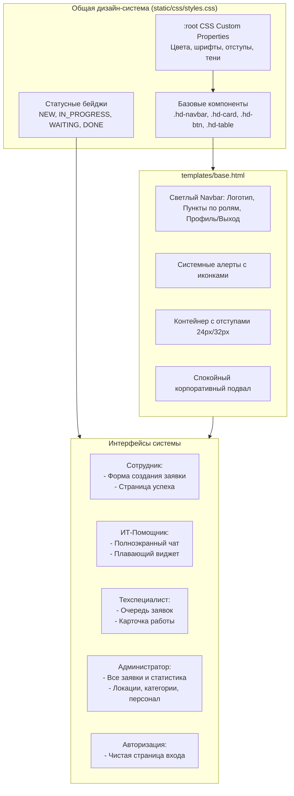

# Комплексный план UX/UI-редизайна Django Help Desk — «Кыргыз Алтын»

## 1. Описание задачи и цели редизайна

Проект **Help Desk «Кыргыз Алтын»** — это внутренняя система технической поддержки горнорудной компании. Текущий интерфейс использует стандартные компоненты Bootstrap 5 с разрозненными стилями (тёмная контрастная навигационная панель, кричащие цвета бейджей, серые вложенные карточки, слабая типографика и неструктурированные таблицы). 

**Главная цель редизайна:**
Создать спокойный, чистый, современный и строгий корпоративный интерфейс, понятный сотрудникам с любым уровнем цифровой грамотности. Пользователь (сотрудник компании) за 1–3 секунды должен безошибочно понимать:
1. Что это за система (Help Desk «Кыргыз Алтын»);
2. Где получить быструю помощь (консультант / база знаний);
3. Как отправить заявку дежурному мастеру без барьеров и лишней сложности.

Редизайн выполняется строго в рамках существующего стека (Django templates, текущий Bootstrap 5, ванильный JS, серверная архитектура) **без изменения бизнес-логики, маршрутов, моделей данных и API**.

---

## 2. Аудит текущих страниц и выявленные проблемы

| Раздел / Экран | Шаблон(ы) | Выявленные проблемы UX/UI и доступности |
| :--- | :--- | :--- |
| **Базовая структура и навигация** | `templates/base.html` | Тёмная перегруженная шапка (`navbar-dark bg-dark`) с кричащим жёлтым бейджем (`badge bg-warning`). Нет визуального выделения активных разделов. Футер визуально оторван. Уведомления (Django messages) оформлены как стандартные Bootstrap-алерты без единой цветовой системы. |
| **Сотрудник: создание заявки** | `templates/public/ticket_create.html` | Вложенный серый блок (`card bg-light`) визуально утяжеляет форму. Кнопка «+ Добавить ещё оборудование» сливается с фоном. Поля на мобильных устройствах не имеют единого ритма отступов. Тексты подсказок блеклые. |
| **Сотрудник: успешная отправка** | `templates/public/ticket_success.html` | Огромный номер заявки `display-6` на сером фоне, чрезмерно яркий зеленый бейдж. Данные заявки свёрстаны в плоский серый прямоугольник. Недостаточно структурирован следующий шаг для пользователя. |
| **ИИ-помощник (страница чата)** | `templates/assistant/chat_page.html` | Левая панель с быстрыми сценариями и правый чат имеют разные визуальные веса. Бейджи режимов (онлайн ИИ / памятка) используют несогласованные цвета. Кнопка эскалации «Оформить заявку» кричаще-жёлтая. Пузыри сообщений бота и пользователя требуют более четкого разграничения и читаемости. |
| **ИИ-помощник (плавающий виджет)** | `templates/assistant/includes/widget.html` | Виджет может перекрывать кнопку отправки формы на мобильных экранах. Шапка виджета ярко-синяя, кнопки быстрых вопросов сжаты. На экранах 360–390px требуется аккуратное позиционирование и безопасная зона снизу. |
| **Очередь техника** | `templates/tech/queue.html` | Переключатель областей (`scope`) оформлен обычной группой кнопок (`btn-group`), которая ломается при переносе строк на экранах планшетов и телефонов. Таблица перегружена: трудно визуально разделить срочные заявки, статус, исполнителя и главное действие («Взять в работу»). Бейдж залежавшихся заявок (`>24ч`) привлекает слишком много агрессивного внимания. |
| **Детали заявки техника** | `templates/tech/ticket_detail.html` | Отсутствует чёткая иерархия рабочей карточки: метаданные, описание проблемы, оборудование и комментарии идут сплошным неструктурированным списком `<p><strong>...</strong></p>`. Форма смены статуса и возврата в очередь визуально сливаются. |
| **Администратор: список заявок** | `templates/manage/ticket_list.html` | Карточки статистики сверху используют грубые цветные полосы слева (`border-start border-4`). Фильтры занимают много места. В таблице тяжело быстро найти неназначенные заявки. |
| **Администратор: управление заявкой** | `templates/manage/ticket_detail.html` | Блоки назначения техника, повторного открытия и комментариев не сбалансированы по высоте и визуальному весу. История изменений оформлена мелким сплошным текстом. |
| **Управление локациями** | `templates/manage/location_list.html`, `location_edit.html` | Левая колонка содержит 3 формы подряд с мелкими полями. Правая колонка содержит 3 таблицы без единого стиля строк и статусов. Форма редактирования не имеет достаточного воздуха. |
| **Управление категориями** | `templates/manage/category_list.html` | Форма добавления и таблица категорий не согласованы по отступам и типографике. |
| **Управление пользователями** | `templates/manage/user_list.html`, `user_form.html`, `user_deactivate.html` | Таблица пользователей не выделяет роли (техник/администратор). Страница деактивации и перераспределения заявок требует более взвешенного оформления предупреждения без тревожного визуального шума. |
| **Вход в систему** | `templates/accounts/login.html` | Стандартный серый каркас, поля ввода без акцента на безопасность и корпоративную принадлежность сервиса. |

---

## 3. Единая дизайн-система и визуальный язык

### 3.1 Цветовая палитра (CSS Custom Properties)

Все цвета фиксируются в корне `:root` в `static/css/styles.css`:

```css
:root {
  /* Базовые поверхности и фон */
  --hd-bg: #F7F9FC;
  --hd-surface: #FFFFFF;
  --hd-surface-subtle: #F8FAFC;
  
  /* Текст и типографика */
  --hd-text-primary: #111827;      /* Контраст 15:1 на фоне #F7F9FC */
  --hd-text-secondary: #475569;    /* Контраст 7.5:1 на белом */
  --hd-text-muted: #64748B;
  
  /* Границы и разделители */
  --hd-border: #D9E1EC;
  --hd-border-subtle: #E2E8F0;
  --hd-border-focus: #93C5FD;

  /* Корпоративный синий акцент */
  --hd-primary: #1D4ED8;           /* WCAG AA доступен */
  --hd-primary-hover: #1E40AF;
  --hd-primary-light: #EFF6FF;
  --hd-primary-border: #BFDBFE;

  /* Семантические состояния */
  --hd-success-bg: #DCFCE7;
  --hd-success-text: #166534;
  --hd-success-border: #BBF7D0;

  --hd-warning-bg: #FEF3C7;
  --hd-warning-text: #92400E;
  --hd-warning-border: #FDE68A;

  --hd-danger-bg: #FEE2E2;
  --hd-danger-text: #991B1B;
  --hd-danger-border: #FECACA;

  --hd-info-bg: #DBEAFE;
  --hd-info-text: #1E40AF;
  --hd-info-border: #BFDBFE;

  /* Радиусы скругления */
  --hd-radius-sm: 6px;
  --hd-radius-md: 10px;
  --hd-radius-lg: 14px;
  --hd-radius-pill: 9999px;

  /* Тени (минимальные, мягкие) */
  --hd-shadow-sm: 0 1px 2px 0 rgba(16, 24, 40, 0.04);
  --hd-shadow-md: 0 2px 6px -1px rgba(16, 24, 40, 0.06), 0 1px 4px -1px rgba(16, 24, 40, 0.03);
  --hd-shadow-lg: 0 10px 25px -3px rgba(16, 24, 40, 0.08), 0 4px 6px -2px rgba(16, 24, 40, 0.04);
}
```

### 3.2 Типографика и ритм отступов
- **Шрифт:** системный стек: `-apple-system, BlinkMacSystemFont, "Segoe UI", Roboto, "Helvetica Neue", Arial, sans-serif`.
- **Базовый кегль:** `16px` (1rem), `line-height: 1.5`, основной цвет `#111827`.
- **Иерархия заголовков:** 
  - `h1`: 24px–28px, semi-bold (600), line-height 1.25.
  - `h2`: 18px–20px, semi-bold (600).
  - `h3` / секции: 15px–16px, semi-bold (600).
  - Мелкий служебный текст: 13px–14px, цвет `#475569`.
- **Шкала отступов:** кратна `8px` (`8px`, `16px`, `24px`, `32px`).

### 3.3 Унифицированные компоненты
1. **Навигация (`.hd-navbar`):**
   - Фон `#FFFFFF`, тонкая нижняя граница `1px solid var(--hd-border)`.
   - Логотип слева с акцентом «Кыргыз Алтын» в спокойных тонах (без ядовито-жёлтых плашек).
   - Активный пункт меню подсвечивается мягким фоном `#EFF6FF`, текстом `#1D4ED8` и полужирным начертанием.
   - Ссылки и доступ по ролям полностью сохраняются.
2. **Карточки (`.hd-card`):**
   - Фон `#FFFFFF`, граница `1px solid var(--hd-border)`, скругление `10px`, тень `var(--hd-shadow-sm)`.
   - Заголовки карточек отделены тонкой аккуратной границей `#E2E8F0`.
3. **Кнопки (`.hd-btn`):**
   - Основная: фон `#1D4ED8`, цвет `#FFFFFF`, при наведении `#1E40AF`.
   - Второстепенная: фон `#FFFFFF`, граница `1px solid var(--hd-border)`, цвет `#111827`, при наведении фон `#F8FAFC`.
   - Действие очереди («Взять в работу»): фон `#DCFCE7`, цвет `#166534`, граница `#BBF7D0`, при наведении более плотный оттенок.
   - Опасное действие: фон `#FEE2E2`, цвет `#991B1B`, граница `#FECACA`.
   - `focus-visible`: `outline: 2px solid #1D4ED8; outline-offset: 2px;`.
4. **Поля ввода и выпадающие списки:**
   - Высота `42px` (десктоп/планшет) и удобный тап на мобильных (`min-height: 44px`).
   - Граница `1px solid var(--hd-border)`, фон `#FFFFFF`, текст `#111827`.
   - При фокусе: граница `#1D4ED8`, мягкое кольцо свечения `box-shadow: 0 0 0 3px rgba(29, 78, 216, 0.15)`.
5. **Статусные бейджи (`.hd-status-badge`):**
   - Статусы не различаются одним лишь цветом: каждый бейдж имеет статусную точку-маркер, контрастный текст и мягкий фоновый цвет.
   - `NEW` (Новая): фон `#DBEAFE`, текст `#1E40AF`, маркер `#1D4ED8`.
   - `IN_PROGRESS` (В работе): фон `#FEF3C7`, текст `#92400E`, маркер `#D97706`.
   - `WAITING` (Ожидание): фон `#FEF3C7`, текст `#92400E`, маркер `#B45309`.
   - `DONE` (Выполнена): фон `#DCFCE7`, текст `#166534`, маркер `#16A34A`.

---

## 4. Архитектурная диаграмма дизайн-системы



---

## 5. Детальный план изменений по экранам

### 5.1 Базовый каркас (`templates/base.html`, `static/css/styles.css`)
- **Шапка:** Замена тёмного `navbar-dark bg-dark` на чистый светлый navbar `.hd-navbar` с логотипом компании:
  - Текстовый логотип: **Help Desk** + аккуратная плашка `«Кыргыз Алтын»` в корпоративном синем/нейтральном стиле.
  - Навигационные ссылки: активный элемент получает класс `active` с синей нижней чертой или мягким фоном.
  - Блок пользователя справа: ФИО и бейдж роли (Техник / Администратор), аккуратная кнопка «Выйти».
  - Для неавторизованных: понятная кнопка «Вход для техслужбы».
- **Сообщения (`messages`):** Стилизация алертов Django под палитру дизайн-системы (спокойный зелёный для успеха, спокойный красный для ошибок) с иконками и кнопкой закрытия.
- **Подвал (`footer`):** Аккуратный, ненавязчивый текст с копирайтом компании на нейтральном фоне.

### 5.2 Интерфейс сотрудника (`templates/public/ticket_create.html`, `ticket_success.html`)
- **`ticket_create.html`:**
  - Превращение формы в структурированную карточку без вложенных серых панелей.
  - Шаг 1: «Кто сообщает и где»:
    - Имя сотрудника (крупное чистое поле, понятный плейсхолдер).
    - Выбор кабинета из списка + аккуратная разворачиваемая или рядом расположенная строка для ручного ввода, если кабинета нет в списке.
  - Шаг 2: «Что неисправно (оборудование)»:
    - Чистая таблица или список строк с понятными заголовками колонок: «Категория оборудования» и «Кол-во».
    - Кнопка «+ Добавить оборудование» оформлена как вторичная кнопка с иконкой `+`.
    - Кнопка удаления строки `×` оформлена аккуратно, чтобы не вызывать визуального шума.
    - **Строго сохраняются:** `id="publicTicketForm"`, `id="addEquipmentRowBtn"`, `id="equipmentRowsContainer"`, `.equipment-row`, `.remove-equipment-row-btn`, `{{ formset.management_form }}`, honeypot-поле.
  - Шаг 3: «Описание проблемы»:
    - Краткое описание (обязательное поле).
    - Подробное описание (необязательное, 3 строки с мягким фокусом).
  - Заметная основная кнопка: «Отправить заявку в техслужбу» (высота 48px, синий цвет `#1D4ED8`, полужирный шрифт).
- **`ticket_success.html`:**
  - Чистая белая карточка с центрированным содержимым.
  - Спокойная зеленая плашка с галочкой: «Заявка успешно зарегистрирована».
  - Чёткий номер заявки (например, `HELP-20261030-001`) в виде крупного заголовка `#111827`.
  - Сводка основных данных в виде аккуратной таблицы со свойствами: Сотрудник, Кабинет, Оборудование, Проблема, Статус «Новая».
  - Первичное действие: «Подать ещё одну заявку» или перейти к ИТ-помощнику.
  - Отсутствие ложных обещаний (сроки и регламенты, не гарантированные системой, не выводятся).

### 5.3 ИТ-помощник и плавающий виджет (`templates/assistant/`, `static/css/assistant.css`, `static/js/assistant.js`)
- **`chat_page.html`:**
  - Двухколоночный макет: слева информационная карточка (статус ИИ, быстрые сценарии, кнопка перехода к тикету), справа рабочая область диалога.
  - Индикатор режима: честный статус «ИИ-консультант онлайн» (зелёный маркер `#166534`) или «Режим памятки (ИИ не подключён)» (спокойный песочный `#92400E`).
  - Быстрые подсказки: интерактивные чипсы (pills) с мягким фоном `#EFF6FF` и тонкой границей.
  - Чат:
    - Сообщения пользователя: прижаты вправо, синий фон `#1D4ED8`, белый текст.
    - Сообщения помощника: прижаты влево, белый фон, граница `#D9E1EC`, текст `#111827`, слева маленькая иконка/аватар бота.
    - Полоса эскалации «Нужен мастер в кабинет?»: спокойная информационная плашка с прямой кнопкой «Оформить заявку».
    - Поле ввода с автоматическим расширением и понятными подсказками по нажатию Enter.
- **`includes/widget.html`:**
  - Лаунчер: плавающая круглая/скругленная кнопка в правом нижнем углу с тенью и высоким контрастом.
  - Панель виджета: на мобильных экранах (до 576px) позиционируется безопасно, не перекрывает форму отправки заявки (`bottom: 80px` или компактная кнопка).
  - Стили виджета гармонизированы с общей дизайн-системой (убраны резкие синие градиенты, внедрены светлые заголовки с разделителем).
- **`static/js/assistant.js`:**
  - Исправление случайного символа `9` в конце файла на корректное закрытие замыкания.
  - Полное сохранение всех `data-*` атрибутов и логики взаимодействия с API `/assistant/api/chat/`.

### 5.4 Интерфейс технического специалиста (`templates/tech/queue.html`, `ticket_detail.html`)
- **`queue.html`:**
  - Сегментированный переключатель областей (`scope`): «Доступные и мои», «Мои в работе», «Все открытые», «Выполненные» в виде аккуратных горизонтальных табов с бейджами количества заявок.
  - Компактная форма фильтрации: поле поиска + выпадающий список статусов + кнопки «Найти» и «Сбросить».
  - Таблица очереди:
    - Столбцы: Номер, Дата/Время, Сотрудник и кабинет, Оборудование, Описание, Статус, Исполнитель, Действия.
    - Если заявка не назначена — четкий маркер «Свободна» (спокойный янтарный/красный бейдж, а не кричащий текст).
    - Залежавшиеся заявки (`>24ч`) получают деликатный бейдж-предупреждение без визуального шума.
    - Кнопка «Взять в работу» доступна прямо из строки таблицы и оформлена как первичное быстрое действие.
    - Мобильный вид: горизонтальный скролл без выпадения за экран, с сохранением читаемости данных.
- **`ticket_detail.html`:**
  - Рабочая карточка специалиста с двумя смысловыми колонками:
    - Слева: вся информация о заявке (кто подал, локация, список оборудования с количеством, описание проблемы, блок результата ремонта) и история рабочих комментариев.
    - Справа: карточки действий (кнопка «Взять заявку в работу» для свободной, форма смены статуса и добавления комментария о ремонте, кнопка возврата в очередь) + хронологический таймлайн истории.

### 5.5 Панель администратора (`templates/manage/`)
- **`ticket_list.html`:**
  - 4 карточки сводки («Всего», «Неназначенные», «Требуют внимания», «Выполнено») с крупными понятными цифрами и мягкими индикаторами.
  - Фильтры: единая строка с выпадающими списками и быстрым сбросом.
  - Таблица заявок с унифицированными бейджами статусов и кнопкой «Управление / Назначить».
- **`ticket_detail.html`:**
  - Панель назначения специалиста (выпадающий список активных техников + примечание).
  - Возможность повторного открытия для завершённых заявок (`DONE`) с обязательным указанием причины.
- **`location_list.html` и `location_edit.html`:**
  - Упорядоченные карточки создания этажей, помещений и зданий.
  - Чёткие таблицы существующих локаций с понятным статусом «Активен / Скрыт».
  - Форма редактирования кабинета/этажа с достаточными отступами и кнопками «Сохранить» / «Отмена».
- **`category_list.html`:**
  - Чистая карточка добавления категории оборудования и аккуратная таблица существующих категорий.
- **`user_list.html`, `user_form.html`, `user_deactivate.html`:**
  - Список специалистов с чётким отображением роли (`Технический специалист` / `Администратор`) и статуса.
  - Форма добавления/редактирования с аккуратными полями пароля, логина и роли.
  - Экран деактивации: ясное предупреждение о количестве незакрытых заявок у сотрудника, аккуратный выбор способа перераспределения (вернуть в очередь или переназначить на другого техника) и кнопка подтверждения.

### 5.6 Экран авторизации (`templates/accounts/login.html`)
- Центрированная карточка входа на спокойном фоне `#F7F9FC`.
- Брендовый заголовок «Вход для технической службы «Кыргыз Алтын»».
- Читаемые поля «Логин» и «Пароль» с явным фокусом и плейсхолдерами.
- Сообщения об ошибках валидации выводятся над формой в спокойном красном блоке.
- Кнопка «Войти в систему» на всю ширину и ссылка «← Вернуться к подаче заявки».

---

## 6. Адаптивность и доступность (Accessibility)

### 6.1 Брейкпоинты и проверка вьюпортов
- **Мобильные устройства (360px – 390px, iPhone SE / iPhone 13/14/15/16):**
  - Никакого горизонтального скролла на странице (`overflow-x: hidden` на базовом контейнере).
  - Все таблицы обёрнуты в контейнеры `.table-responsive` с плавной прокруткой.
  - Минимальный размер кликабельной области кнопок и полей: `44 × 44px`.
  - Динамические строки оборудования в форме заявки стекаются вертикально при необходимости, кнопка удаления не перекрывает поля ввода.
  - Плавающий виджет помощника имеет безопасный отступ снизу (`bottom: 1rem; right: 1rem`) и не перекрывает кнопку отправки тикета.
- **Планшеты (768px – 1024px, iPad):**
  - Двухколоночные макеты аккуратно перестраиваются без наложения панелей.
  - Фильтры очередей складываются в компактную сетку 2×2.
- **Десктопы (1280px – 1440px+):**
  - Ограничение максимальной ширины контента (`container` до 1280px) для исключения слишком длинных строк текста (оптимальная длина строки 60–80 символов для комфортного чтения).

### 6.2 Доступность (a11y)
- **Контрастность:**
  - Основной текст `#111827` на фоне `#F7F9FC` и `#FFFFFF` даёт контраст более **15:1** (при норме WCAG AA 4.5:1).
  - Вторичный текст `#475569` даёт контраст **7.5:1**.
  - Кнопка `#1D4ED8` с белым текстом даёт контраст **7.0:1** (норма AAA).
- **Семантика и экранные дикторы:**
  - Сохранение тегов `<main>`, `<nav>`, `<header>`, `<footer>`, `<section>`.
  - Все поля форм имеют явные теги `<label for="...">`.
  - Ошибки валидации имеют `aria-live="polite"` или семантическую связь с полями.
  - Сохранение атрибутов доступности виджета: `aria-expanded`, `aria-controls`, `aria-label`.
- **Клавиатурная навигация:**
  - Явный `:focus-visible` на всех интерактивных элементах (кнопки, ссылки, инпуты, селекты, чипсы).

---

## 7. Матрица сохранения стабильности и безопасности

| Ограничение | Способ обеспечения при редизайне |
| :--- | :--- |
| **Незакоммиченные изменения** | Перед началом работы зафиксирован статус `git status`. Файлы `requirements.txt`, `config/settings.py`, `config/urls.py`, `apps/assistant/`, `.env.example` не перезаписываются и сохраняются. |
| **База данных и миграции** | Никаких миграций не создаётся, файлы моделей (`models.py`) не модифицируются. |
| **Бизнес-логика и права** | Вся авторизация, проверки ролей (`is_tech_role`, `is_admin_role`), сервис перераспределения заявок остаются без изменений. |
| **Идентификаторы JS и Formset** | Сохраняются неизменными `id="publicTicketForm"`, `id="addEquipmentRowBtn"`, `id="equipmentRowsContainer"`, `id="id_items-TOTAL_FORMS"`, класс `.equipment-row`, селектор `.remove-equipment-row-btn`. |
| **API ИТ-помощника** | Сохраняются неизменными `data-assistant-container`, `data-api-url`, `data-ticket-url`, `data-max-length`, `data-assistant-messages`, `data-assistant-form`, `data-assistant-input`, `data-assistant-submit`, `data-assistant-counter`, `data-assistant-escalation`, `data-assistant-error-bar`, `data-assistant-toggle`, `data-assistant-close`. |
| **Секреты и .env** | Файл `.env` не читается в логи, не выводится пользователю, ключи API не передаются в шаблоны. |
| **Деплой и внешние системы** | Никаких команд деплоя, пушей в Git или изменений инфраструктуры. |

---

## 8. Затрагиваемые файлы проекта

### Новые файлы / Базовые стили
- `static/css/styles.css` — полная реализация дизайн-системы, токенов, компонентов, бейджей, форм и таблиц.
- `static/css/assistant.css` — синхронизация стилей чата и виджета с единой дизайн-системой.
- `static/js/assistant.js` — удаление артефакта синтаксиса в конце файла, сохранение логики.

### Модифицируемые шаблоны
1. `templates/base.html` — светлый navbar, аккуратные алерты, корпоративный футер.
2. `templates/public/ticket_create.html` — чистая пошаговая карточка подачи заявки без серых плашек.
3. `templates/public/ticket_success.html` — спокойная карточка подтверждения заявки со сводкой.
4. `templates/assistant/chat_page.html` — корпоративный вид чата ИТ-помощника, быстрые чипсы, понятные сообщения.
5. `templates/assistant/includes/widget.html` — безопасный плавающий виджет без перекрытия форм.
6. `templates/tech/queue.html` — сегментированные табы очереди, контрастная таблица, понятные кнопки действий.
7. `templates/tech/ticket_detail.html` — рабочая карточка техника, структурированные блоки диагностики и действий.
8. `templates/manage/ticket_list.html` — чистые карточки метрик администратора, таблица всех заявок.
9. `templates/manage/ticket_detail.html` — экран управления заявкой, назначение мастера, история изменений.
10. `templates/manage/location_list.html` — аккуратные формы добавления и таблицы этажей/кабинетов.
11. `templates/manage/location_edit.html` — центрированная карточка редактирования кабинета/этажа.
12. `templates/manage/category_list.html` — управление категориями оборудования.
13. `templates/manage/user_list.html` — таблица специалистов с ролями и активностью.
14. `templates/manage/user_form.html` — форма создания/редактирования специалиста.
15. `templates/manage/user_deactivate.html` — безопасный диалог деактивации и перераспределения заявок.
16. `templates/accounts/login.html` — корпоративная форма входа персонала.

---

## 9. План проверки и контроля качества

### 9.1 Автоматизированные тесты
Команды для выполнения после внедрения каждого этапа и в финале:
```bash
# 1. Системная проверка Django
python manage.py check

# 2. Проверка синтаксиса и пробелов Git
git diff --check

# 3. Полный запуск приёмочных тестов Helpes
pytest tests/test_helpes_acceptance.py -v

# 4. Проверка тестов интерфейса и помощника (без внешнего сетевого вызова к OpenRouter)
pytest tests/test_ai_assistant.py -k "not test_live_openrouter_call_via_django_service" -v

# 5. Проверка конфигурации Docker
docker compose config -q
```

### 9.2 Ручная проверка сценариев в браузере (локальный запуск Django dev server)
1. **Сценарий обычного сотрудника (неавторизованный):**
   - Открытие `/` (форма создания заявки).
   - Проверка внешнего вида на ширине 390px, 768px и 1440px.
   - Проверка добавления второй и третьей строки оборудования через кнопку «+ Добавить оборудование».
   - Удаление строки оборудования через `×`.
   - Проверка сообщений об ошибках валидации (пустая форма).
   - Заполнение формы и успешная отправка -> переход на `/success/HELP-.../`.
   - Проверка карточки успеха: номер, реквизиты, кнопка создания новой заявки.
2. **Сценарий ИТ-помощника:**
   - Открытие `/assistant/`.
   - Отправка тестового вопроса и клик по быстрой подсказке («Не печатает принтер»).
   - Проверка пузырей сообщений (пользователь vs помощник).
   - Проверка работы плавающего виджета на главной странице: открытие, закрытие по `Esc` и кнопке `×`, фокусировка на форме по ссылке «Заполнить форму заявки».
3. **Сценарий техника:**
   - Вход под учётной записью техника.
   - Просмотр очереди заявок (`/tech/queue/`): переключение вкладок (`available`, `mine`, `all_open`, `done`), фильтрация по статусу.
   - Взятие заявки в работу («Взять в работу»).
   - Переход в карточку заявки: добавление комментария, обновление статуса, завершение ремонта с указанием результата.
4. **Сценарий администратора:**
   - Вход под учётной записью администратора.
   - Просмотр сводки и списка заявок (`/manage/tickets/`).
   - Назначение исполнителя на заявку.
   - Просмотр и редактирование кабинетов/этажей (`/manage/locations/`).
   - Просмотр списка пользователей (`/manage/users/`), открытие формы редактирования.
   - Проверка экрана деактивации техника с открытыми заявками.

---

## 10. Вопросы для согласования с пользователем

> [!NOTE]
> Все цвета и визуальные элементы строго соответствуют заданным в запросе спецификациям (палитра `#F7F9FC`, `#FFFFFF`, `#111827`, `#475569`, `#D9E1EC`, `#1D4ED8`).
> Для иконок (плюс, закрыть, стрелки) мы используем аккуратные чистые SVG/CSS символы без подключения тяжелых внешних библиотек вроде FontAwesome, чтобы не замедлять загрузку страниц.

План готов к выполнению. После подтверждения реализация начнётся последовательно:
1. Создание дизайн-системы и обновление базового каркаса (`styles.css`, `base.html`).
2. Редизайн экранов сотрудника (`ticket_create.html`, `ticket_success.html`).
3. Редизайн ИТ-помощника и виджета (`assistant.css`, `chat_page.html`, `widget.html`).
4. Редизайн интерфейсов техника (`queue.html`, `ticket_detail.html`).
5. Редизайн интерфейсов администратора (`manage/*.html`).
6. Редизайн экрана авторизации (`login.html`).
7. Полная верификация тестами и системными чеками.
